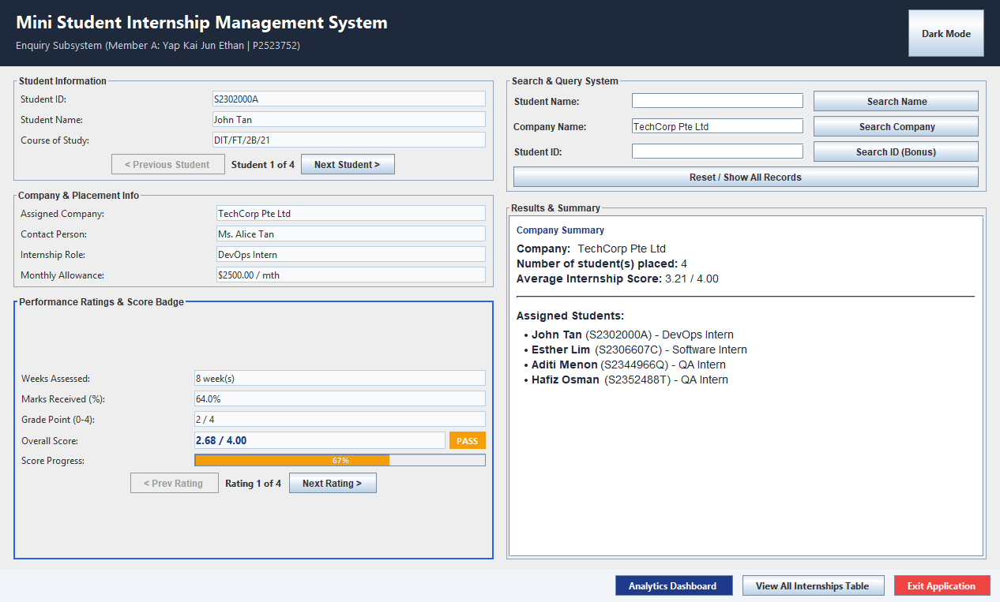

# Student Internship Management System

A Java Swing desktop app for managing student internship placements: searching placements, rating students' performance and reporting on each host company. Built as a pair project for ST0509 Java Programming (JPRG) at Singapore Polytechnic, 2026.

**Live demo:** none, it's a desktop app. See [Getting started](#getting-started) to run it.

[](https://github.com/EthanYap123/internship-management-system/actions/workflows/ci.yml)



## Team

| Member | Subsystem |
|---|---|
| **Yap Kai Jun Ethan** ([@EthanYap123](https://github.com/EthanYap123)) | Member A: Internship Enquiry System |
| **Tay Yu Xiang Janston** ([@JanstonTay](https://github.com/JanstonTay)) | Member B: Internship Admin System |

Every source file starts with a header saying which member wrote it.

## Features

### Enquiry System (Member A: Ethan)
- Browse every placement one student at a time, with company, role, allowance and each performance rating
- Search by student name (case-insensitive), by company, or by student ID (regex-validated `S1234567` format)
- Company search shows the headcount, the average internship score and the list of assigned students
- Colour-coded grade badges and a score progress bar for each student
- Light and dark themes, a table of all internships, and an analytics dashboard
- Reads and writes the company and student data in `internships.txt` (`FileHandler`)

### Admin System (Member B: Janston)
- Create, search, rate and delete student internship records, with full input validation
- Tabbed interface with a sortable, filterable student table and a live result count
- Rating history table with delete-a-rating and a live preview of the score impact
- Data integrity alerts (low scores, missing ratings, declining performance) with colour-coded severity
- Activity log, unsaved-changes indicator, undo for the last deletion and keyboard shortcuts
- Saves everything to an object-serialized file (`internships.dat`) with timestamped backups

Both subsystems share one `InternshipManagement` object, so a change made in one is visible in the other straight away.

## Tech stack

Java 17, Swing (forms built in NetBeans), object-oriented design, text-file and object-serialized storage. CI runs on GitHub Actions.

## Architecture

`InternshipUser` is the entry point: it asks which subsystem to open. Both subsystems share one `InternshipManagement` object that holds the `Company` and `Student` records, so a change in one is visible in the other straight away.

- **Enquiry System (Ethan):** `InternshipEnquiryGUI`.
- **Admin System (Janston):** `InternshipAdminGUI`, `InternshipAdmin`, the `StudentTableModel` and `RatingTableModel` table models, `ActivityLog`, `DataIntegrityChecker` and `DeletedRecord` (undo).
- **Storage (both):** `FileHandler` holds Ethan's text-file reading and writing for `internships.txt` and Janston's object-serialized `internships.dat` with timestamped backups.

## Scoring

Each performance rating is a number of weeks assessed and a mark out of 100, converted to a grade point (80+ = 4, 70+ = 3, 60+ = 2, 50+ = 1). A student's overall score is the grade points weighted by weeks, out of 4.00.

## Getting started

**NetBeans:** open the folder as a project and run it. The main class is `InternshipUser`.

**Command line** (JDK 17 or newer):

```bash
javac -d out src/*.java
java -cp out InternshipUser
```

Run it from the project folder so it finds `internships.txt`. Pick **1** for the Enquiry System or **2** for the Admin System.

## Sample data

`internships.txt` holds made-up sample data: 10 companies and 36 students across six classes, with 0 to 4 ratings each. A few records are deliberately unusual (low scores, no ratings yet, declining marks, a company with no interns) so the Admin System's integrity alerts have something to show.

The file format is a company count, one `name;contact person;monthly allowance` line per company, then a student count and one line per student:

```
course;student ID;name;company;role;number of ratings;weeks;marks;weeks;marks;...
```

## Testing and CI

There is no automated test suite yet. Both subsystems were tested by hand against the sample data, including its deliberately unusual records.

[`.github/workflows/ci.yml`](.github/workflows/ci.yml) runs on every push to `main` and every pull request: it compiles every source file on Java 17 (the NetBeans project's target) and packages a runnable jar, which is kept as a build artifact for 14 days.

## What I'd improve next

- Add JUnit tests for the search logic and the scoring formula, which are easy to test on their own.
- Agree on the shared classes and file format with my partner on day one, as the section below explains.

## What I learned

- Janston and I built our subsystems separately and only joined them near the deadline, so we spent the last stretch fixing clashes between our code under time pressure.
- Next time I'd agree on the shared classes and data format on day one and integrate early and often, so problems show up while there's still time to fix them calmly.
