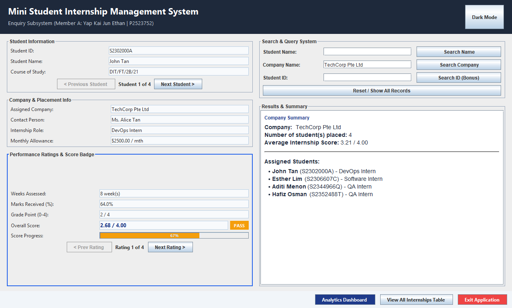

# Student Internship Management System

A Java Swing desktop app for managing student internship placements: searching placements, rating students' performance and reporting on each host company. Built as a pair project for ST0509 Java Programming (JPRG) at Singapore Polytechnic, 2026.



## Team

| Member | Subsystem |
|---|---|
| **Yap Kai Jun Ethan** ([@EthanYap123](https://github.com/EthanYap123)) | Member A: Internship Enquiry System |
| **Tay Yu Xiang Janston** ([@JanstonTay](https://github.com/JanstonTay)) | Member B: Internship Admin System |

Every source file starts with a header saying which member wrote it.

## Features

### Enquiry System (Member A: Ethan)
- Browse every placement one student at a time, with company, role, allowance and each performance rating
- Search by student name (case-insensitive), by company, or by student ID (regex-validated `S1234567` format)
- Company search shows the headcount, the average internship score and the list of assigned students
- Colour-coded grade badges and a score progress bar for each student
- Light and dark themes, a table of all internships, and an analytics dashboard
- Reads and writes the company and student data in `internships.txt` (`FileHandler`)

### Admin System (Member B: Janston)
- Create, search, rate and delete student internship records, with full input validation
- Tabbed interface with a sortable, filterable student table and a live result count
- Rating history table with delete-a-rating and a live preview of the score impact
- Data integrity alerts (low scores, missing ratings, declining performance) with colour-coded severity
- Activity log, unsaved-changes indicator, undo for the last deletion and keyboard shortcuts
- Saves everything to an object-serialized file (`internships.dat`) with timestamped backups

Both subsystems share one `InternshipManagement` object, so a change made in one is visible in the other straight away.

## Scoring

Each performance rating is a number of weeks assessed and a mark out of 100, converted to a grade point (80+ = 4, 70+ = 3, 60+ = 2, 50+ = 1). A student's overall score is the grade points weighted by weeks, out of 4.00.

## Running it

**NetBeans:** open the folder as a project and run it. The main class is `InternshipUser`.

**Command line** (JDK 17 or newer):

```bash
javac -d out src/*.java
java -cp out InternshipUser
```

Run it from the project folder so it finds `internships.txt`. Pick **1** for the Enquiry System or **2** for the Admin System.

## Sample data

`internships.txt` holds made-up sample data: 10 companies and 36 students across six classes, with 0 to 4 ratings each. A few records are deliberately unusual (low scores, no ratings yet, declining marks, a company with no interns) so the Admin System's integrity alerts have something to show.

The file format is a company count, one `name;contact person;monthly allowance` line per company, then a student count and one line per student:

```
course;student ID;name;company;role;number of ratings;weeks;marks;weeks;marks;...
```

## What I learned

- Splitting a project with a partner meant agreeing on shared file formats and loading code early, before we each built our own subsystem.
